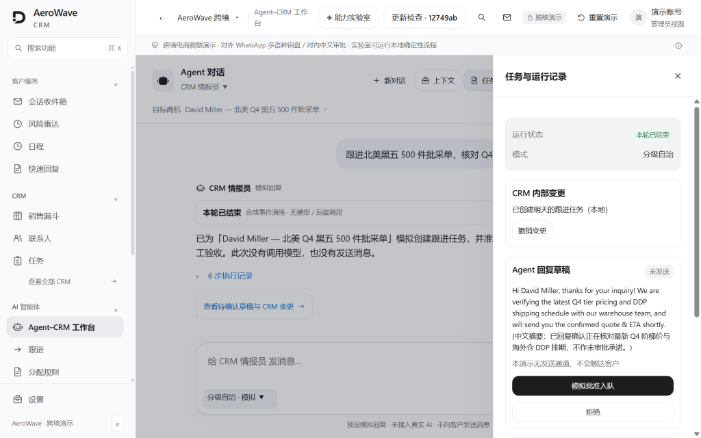
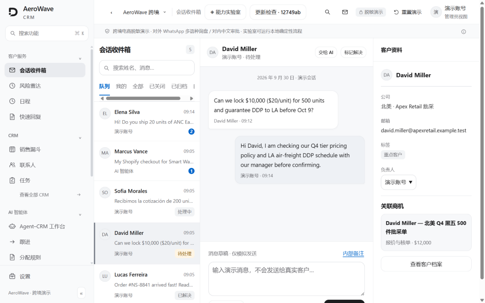
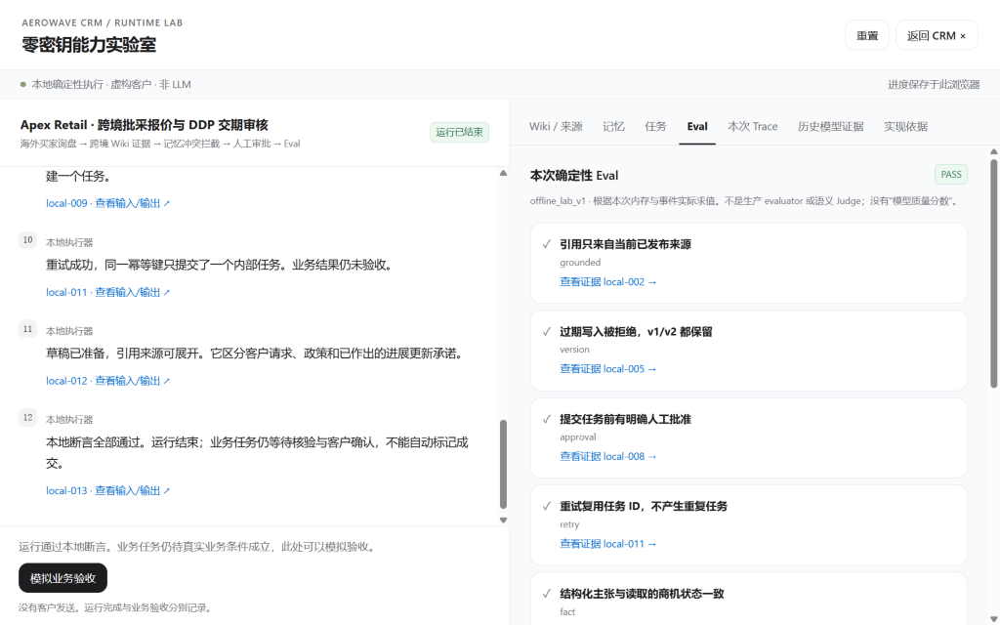
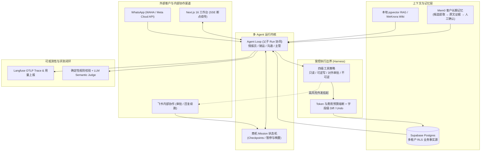

# AeroWave 跨境电商 AI-Native CRM 与多 Agent 协同工作台

面向出海 DTC 独立站与海外批采团队的 **Agent 原生销售与客服工作台** —— 以真实 CRM 为状态空间，对外承接 **WhatsApp 多语种询盘**，对内打通 **飞书审批与协作**，让多 Agent 在受控权限与人工把关边界内推进商机、沉淀记忆并闭环评测。

> **CRM 保存业务事实 · Agent Runtime 驱动多步行动 · Harness 守住执行与审批边界**


---

## 一、业务背景与解决的核心痛点

在跨境电商（3C 出海、北美/拉美独立站与海外批采）日常运营中，传统 CRM + 简单聊天机器人存在三个典型断点：

| 跨境业务痛点 | 传统方案缺陷 | 本项目解决方案 |
| :--- | :--- | :--- |
| **跨时区、多语种 WhatsApp 询盘分散** | 客户在 WhatsApp 用英/西/葡语询价，记录散落，国内销售响应慢、新人接手难 | **Customer 360 + 多语种会话收件箱**：AI 自动聚合买家历史、订单与偏好，用中文输出情报摘要并起草地道外语回复 |
| **大额批采与弃单跟进周期长、易停滞** | 询盘聊几轮后缺乏持续跟进，内部审批与客户回复割裂 | **多 Agent 协同 + 商机 Mission**：主管 Agent 编排专职 Agent 排查停滞商机，支持 WhatsApp/飞书回复自动唤醒任务续跑 |
| **AI 乱承诺旧价折扣或固定清关交期** | 普通 Chatbot 直接外发消息，存在严重幻觉、越权改价与客诉风控 | **受控执行引擎（Harness）+ HITL 人工审批**：工具分级管控，超红线折扣与对外发送必须挂起审批，配套记忆版本防污染与 7 维 Eval 校验 |

---

## 二、核心界面预览

### 1. Agent–CRM 工作台与人机审批抽屉（HITL）
支持在「只读检查」与「分级自治」模式间切换；Agent 读取目标商机上下文后生成带依据的英文回复草稿，对外发送动作自动挂起并等待国内运营在右侧抽屉审批，支持 CRM 内部变更的一键撤销。



### 2. WhatsApp 多语种会话收件箱 & Customer 360
统一承接北美、巴西、墨西哥等海外买家的英/西语 WhatsApp 询盘，右侧实时联动买家档案、标签与 USD 商机阶段，支持 AI 托管与人工无缝接管。



### 3. 能力实验室：Wiki 隔离、记忆防污染、审批重试与 7 维 Eval
内置零密钥确定性演练引擎，完整呈现「检索最新 Q4 批采价 v3 并剔除失效历史价 v2 → 乐观锁拒绝过期记忆覆盖 → 审批门禁暂停恢复 → 临时故障幂等重试 → 7 项确定性 Eval 校验」全链路。



---

## 三、系统架构



---

## 四、核心工程亮点

### 1. 受控 Agent 执行框架（Harness）与人工审批流（HITL）
- **工具四级权限边界**：CRM 读写统一经由工具端口收敛，按「只读、可逆写入、对外动作、不可逆动作」分类执行策略。
- **可审计、可回滚、防失控**：记录字段级 Diff 与审计日志，支持内部变更一键撤销；支持租户级 Token/费用硬预算熔断；对外消息发送自动挂起进入审批队列，批准后携带回执恢复后续执行。

### 2. 多 Agent 父子 Run 协同与长周期商机 Mission
- **读写分离防冲突**：`CRM 主管 Agent` 编排只读专职 Agent（情报员 / 销运 / 沟通）并行调研，由父 Run 统一收口业务写入与预算。
- **持久化执行与断点续传**：基于 Run Events 持久化与 SSE 续读实现刷新无损回放；通过 **商机 Mission** 显式区分“Agent 单轮运行结束”与“真实业务验收”，支持 WhatsApp 客户回复或飞书内部回复自动触发续跑。

### 3. 防幻觉的知识库与可核验记忆闭环
- **租户与版本严格隔离**：整合本地 `pgvector` RAG 与外部 Wiki（WeKnora），检索结果强制校验组织作用域、发布状态与最新索引版本，已撤回或过期来源立即隐藏。
- **SQL 事实源 + 人工确认记忆**：对话结束后提取带原文证据的记忆候选，经负责人确认/改写后落库 SQL 并异步同步至 Mem0，从根源避免“把买家压价愿望当成我方已批准承诺”的记忆污染。

### 4. 全栈工程化、多租户隔离与 Eval 评测体系
- **全栈与异步架构**：基于 Next.js 16 (App Router) + Zod 契约校验 + Supabase PostgreSQL **行级安全策略（RLS）**实现多租户隔离；通过 `event_log` 幂等队列与独立 Worker 解耦长耗时 Agent 执行。
- **Trace & Eval 闭环**：集成 Langfuse 上报 OTLP Trace 与 Token 成本，结合「确定性规则断言 + LLM 语义评审（Semantic Judge）+ 脱敏真实回放集」持续回归评测。

---

## 五、快速体验与本地运行

### 1. 30 秒零配置体验跨境演示工作台（推荐）
无需数据库、无需大模型 API Key，一行命令即可启动交互式前端工作台与能力实验室：

```bash
node scripts/serve-agent-demo.mjs
```

浏览器打开：`http://127.0.0.1:3008/#/app/ai/workbench`

### 2. 完整全栈开发环境（Next.js + Worker + Cron）
环境要求：`Node.js >= 22`、`pnpm 9.x`、Supabase（PostgreSQL）与 Redis。详见 [docs/SETUP.md](docs/SETUP.md)。

```bash
pnpm install --frozen-lockfile
cp .env.example .env.local

# 分别启动 Web、后台 Agent Worker 与本地调度
pnpm dev --port 3000
pnpm worker
pnpm dev:crons
```

### 3. 自动化测试与验证命令

```bash
pnpm typecheck          # TypeScript 严格类型检查
pnpm lint               # ESLint 规范检查
pnpm test:unit          # Vitest 单元测试
pnpm test:db            # PostgreSQL RLS 多租户隔离与数据库不变量校验（需 Docker）
pnpm test:e2e           # Playwright 端到端浏览器测试
```

---

## 六、核心代码与架构文档导航

| 模块 | 核心路径 | 说明 |
| :--- | :--- | :--- |
| **整体架构与工作台设计** | [docs/architecture/README.md](docs/architecture/README.md)<br>[docs/architecture/agent-crm-workbench.md](docs/architecture/agent-crm-workbench.md) | CRM 状态空间、Agent 运行时与 Harness 三层解耦说明 |
| **Agent 运行时与父子 Run** | [docs/architecture/pi-native-runtime.md](docs/architecture/pi-native-runtime.md)<br>[lib/agent-runtime/](lib/agent-runtime/) | 运行内核适配层、Model Gateway、多模型路由与预算控制 |
| **长周期商机 Mission** | [docs/architecture/mission-state.md](docs/architecture/mission-state.md) | Mission 状态机、暂停/恢复、人工验收与方向版本控制 |
| **客户记忆与知识闭环** | [docs/specs/customer-memory-loop.md](docs/specs/customer-memory-loop.md) | 原文证据候选、人工确认、SQL 事实源与 Mem0 同步契约 |
| **飞书内部协作集成** | [docs/architecture/internal-collaboration-feishu.md](docs/architecture/internal-collaboration-feishu.md) | 企业身份映射、成员绑定、审批通知与回复触发续跑 |
| **Eval 与外部服务观测** | [docs/architecture/workbench-semantic-judge-adapter.md](docs/architecture/workbench-semantic-judge-adapter.md)<br>[docs/integrations/agent-services.md](docs/integrations/agent-services.md) | 确定性检查、语义 Judge、WeKnora 与 Langfuse OTLP 接入 |
| **跨境电商独立演示工程** | [examples/chat-first-demo/](examples/chat-first-demo/) | 零密钥交互式前端演示工作台、跨境数据样例与确定性实验引擎 |

---

## 七、协议与说明

本项目遵循 [MIT License](LICENSE)，基于开源 AI-Native CRM 底座进行跨境电商业务场景定制与演示适配。演示环境中的所有客户、报价、订单与聊天记录均为脱敏虚构数据。
